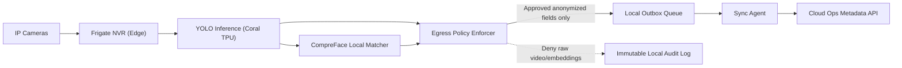

# Implementation Plan: Edge Private Video Metadata

**Branch**: `008-edge-private-video-metadata` | **Date**: 2026-07-22 | **Spec**: [spec.md](./spec.md)

## Summary
Establish the Phase 2 foundation Edge Box stack per site using Frigate + YOLO + CompreFace on Coral TPU so camera ingest and perception run fully on-premise. Publish only anonymized operational metadata to cloud; raw video and face embeddings never leave the building.

## Technical Context
- **Language/Version**: TypeScript 5.x (orchestration), Python 3.11+ (local CV workers)
- **Primary Dependencies**: Nx monorepo, NestJS services, Frigate NVR, YOLO detector, CompreFace matcher, Coral TPU runtime, Docker Compose/k3s, RabbitMQ or NATS
- **Storage**: Local Edge Box store for transient media/indexes; PostgreSQL (cloud) for anonymized metadata + audits
- **Target Platform**: On-prem Edge Box appliance + cloud control plane
- **Hardware Dependencies**: Industrial mini-PC Edge Box, Coral USB/PCIe TPU, secured local SSD, tamper switch, UPS, PoE camera network
- **Local Inference Models**: YOLO (person/object), CompreFace (local embedding/match), Frigate motion/event extraction
- **Sync Strategy**: Durable local outbox queue with schema allowlist validator, idempotent cloud publish, backpressure and retry with ordering keys
- **Constraints**: No AI inference in cloud for raw media; no prohibited egress; offline-first local continuity

## Constitution Check (Pre-Design)
- Privacy by default and edge-first inference: PASS
- Explicit consent and child dignity: PASS (consent-aware biometric gating)
- Safety-first non-diagnostic boundaries: PASS
- Phase sequencing obligations: PASS (Phase 2 foundation)
- Architecture integrity and offline continuity: PASS

## Project Structure
```text
specs/008-edge-private-video-metadata/
├── plan.md
├── research.md
├── data-model.md
├── quickstart.md
└── contracts/
    └── api-contracts.md
```

## Edge Box Software Components
- Frigate NVR ingest and event extraction service
- YOLO inference worker bound to Coral TPU acceleration
- CompreFace local biometric service (site-local only)
- Egress Policy Enforcer (deny raw media/embeddings)
- Metadata Outbox + Sync Agent
- Local Health/Telemetry and Tamper Monitor

## Data Flow Diagram


## Prisma Data Model Plan
See [data-model.md](./data-model.md).

## API Contracts Plan
See [contracts/api-contracts.md](./contracts/api-contracts.md).

## Testing Strategy
- Unit: egress allowlist, deny rules, outbox idempotency
- Integration: Frigate -> YOLO -> policy -> outbox -> cloud sync
- Hardware-in-loop: Coral TPU inference throughput and failover
- Security: tamper-trigger wipe, prohibited payload rejection
- Offline: long outage queue growth and replay
- Compliance: 0 prohibited media egress verification

## Compliance Checks
- Raw video and face embeddings never leave building
- Region-aware retention, secure auto-delete defaults
- Immutable policy/audit traces for egress and config changes

## Post-Design Constitution Check
PASS: all high-order constraints preserved; no unjustified violations.
