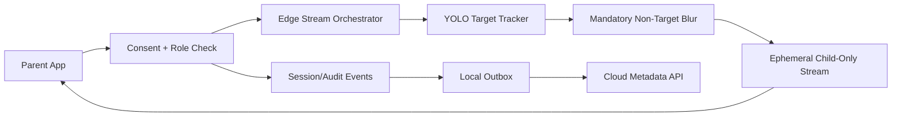

# Implementation Plan: Opt-In Child Livestream

**Branch**: `009-optin-child-livestream` | **Date**: 2026-07-22 | **Spec**: [spec.md](./spec.md)

## Summary
Deliver parent livestream that follows only the consented child across cameras, with mandatory blur/anonymization of all non-consented children at the edge before stream rendering. Continuous footage storage is disallowed.

## Technical Context
- **Language/Version**: TypeScript 5.x, Python 3.11+
- **Primary Dependencies**: Nx, NestJS access/session services, Frigate stream pipeline, YOLO tracker, CompreFace local identity binding, edge blur compositor
- **Storage**: Session/audit metadata only; no continuous livestream archive
- **Hardware Dependencies**: Edge Box + Coral TPU + low-latency LAN streaming path
- **Local Inference Models**: YOLO tracking, CompreFace local subject linkage, edge masking model
- **Sync Strategy**: Session metadata + privacy control events synced via outbox; stream itself remains local ephemeral transport
- **Constraints**: Mandatory ethical blur for all non-consented/non-target children

## Constitution Check (Pre-Design)
- Edge-first inference and privacy: PASS
- Explicit consent gating: PASS
- Non-diagnostic boundaries: PASS
- Phase sequencing: PASS
- Offline continuity compatibility: PASS

## Edge Box Software Components
- Child-target tracker service
- Consent/authorization gate cache
- Non-target blur compositor (mandatory)
- Camera handoff coordinator
- Session audit + sync outbox

## Data Flow Diagram

## Prisma Data Model Plan
See [data-model.md](./data-model.md).

## API Contracts Plan
See [contracts/api-contracts.md](./contracts/api-contracts.md).

## Testing Strategy
- Unit: consent checks, target selection, blur enforcement
- Integration: cross-camera handoff continuity
- Privacy: non-target visibility leakage tests
- Offline: local session continuity during WAN outage
- Compliance: no continuous footage persistence checks

## Compliance Checks
- Parent access only for valid parent-child consent
- Non-target blur always on
- No archive of continuous livestream footage

## Post-Design Constitution Check
PASS: consent-first and edge-only privacy guarantees maintained.
