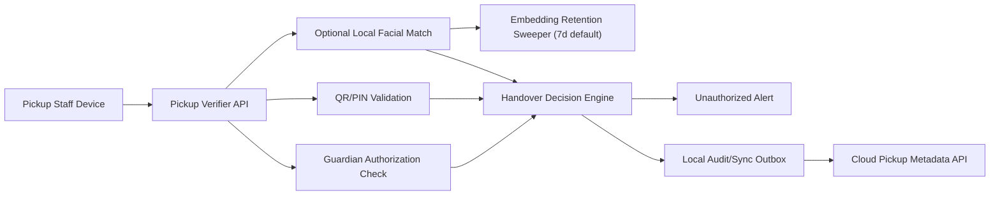

# Implementation Plan: Pickup Guardian Verification

**Branch**: `010-pickup-guardian-verification` | **Date**: 2026-07-22 | **Spec**: [spec.md](./spec.md)

## Summary
Provide safe pickup verification using QR, PIN, and optional local facial match. Facial matching runs only on Edge Box and embeddings auto-delete after configurable retention (default 7 days). Unauthorized attempts generate immediate alerts and full audit traces.

## Technical Context
- **Language/Version**: TypeScript 5.x, Python 3.11+
- **Primary Dependencies**: Nx, NestJS pickup service, edge identity verifier, CompreFace local match engine
- **Storage**: Pickup audit metadata in cloud; local biometric cache with retention sweeper
- **Hardware Dependencies**: Pickup tablet/kiosk camera, Edge Box with Coral TPU support
- **Local Inference Models**: CompreFace local embedding and match
- **Sync Strategy**: offline-first pickup actions via local queue; cloud reconciliation with idempotent handover IDs
- **Constraints**: facial match local only; no embedding export; default biometric retention 7 days

## Constitution Check (Pre-Design)
- Privacy and edge inference: PASS
- Consent lifecycle enforcement: PASS
- Non-diagnostic scope: PASS
- Phase sequencing: PASS
- Offline continuity compatibility: PASS

## Edge Box Software Components
- Pickup verifier API (QR/PIN)
- Optional local facial verifier
- Consent and authorization cache
- Biometric retention sweeper (default 7-day auto-delete)
- Unauthorized attempt alert publisher

## Data Flow Diagram

## Prisma Data Model Plan
See [data-model.md](./data-model.md).

## API Contracts Plan
See [contracts/api-contracts.md](./contracts/api-contracts.md).

## Testing Strategy
- Unit: method validators, consent gates, retention windows
- Integration: verification -> decision -> alert -> audit
- Security: embedding egress denial and retention purge proofs
- Offline: outage pickup operations and replay consistency

## Compliance Checks
- Optional facial path blocked without consent
- Embeddings retained locally and auto-deleted by policy
- Immutable handover and denial history

## Post-Design Constitution Check
PASS: local-only biometric processing and retention mandates satisfied.
