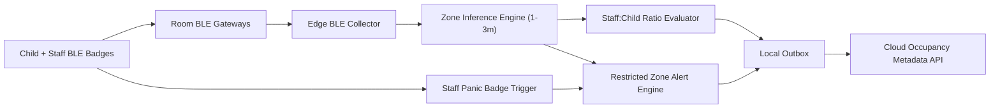

# Implementation Plan: BLE Zone Headcount

**Branch**: `011-ble-zone-headcount` | **Date**: 2026-07-22 | **Spec**: [spec.md](./spec.md)

## Summary
Deploy tamper-resistant child badges and room gateways to provide live room-level headcount and automatic ratio verification. Include panic badges for staff and enforce room-level positioning accuracy target of 1-3 meters.

## Technical Context
- **Language/Version**: TypeScript 5.x, embedded gateway firmware integrations
- **Primary Dependencies**: Nx, NestJS occupancy engine, BLE gateway mesh, policy/alert service
- **Storage**: local edge occupancy state + cloud metadata/audit persistence
- **Hardware Dependencies**: tamper-resistant BLE child badges, BLE staff panic badges, per-room gateways, Edge Box BLE collector
- **Local Inference Models**: BLE trilateration/signal fusion heuristics (non-video)
- **Sync Strategy**: local occupancy ledger with periodic cloud snapshots and event outbox replay
- **Constraints**: 1-3m accuracy at room level, deterministic alerting on restricted zone and ratio breaches

## Constitution Check (Pre-Design)
- Privacy and edge-first processing: PASS
- Consent and dignity controls: PASS
- Non-diagnostic operations: PASS
- Phase sequencing (Phase 2 BLE pilot): PASS
- Offline continuity: PASS

## Edge Box Software Components
- BLE collector and signal normalizer
- Zone inference engine
- Ratio compliance evaluator
- Restricted zone + panic alert router
- Offline occupancy ledger and sync agent

## Data Flow Diagram

## Prisma Data Model Plan
See [data-model.md](./data-model.md).

## API Contracts Plan
See [contracts/api-contracts.md](./contracts/api-contracts.md).

## Testing Strategy
- Unit: zone state transitions, signal conflict resolution
- Integration: gateway telemetry -> zone -> ratio/alerts
- Field tests: 1-3m room-level calibration
- Reliability: panic badge trigger latency and escalation
- Offline: gateway outage and replay reconciliation

## Compliance Checks
- Operational metadata only to cloud
- Badge tamper events and panic flows auditable
- Restricted-zone/ratio alerts immutable

## Post-Design Constitution Check
PASS: BLE safety scope aligns with architecture and privacy constraints.
