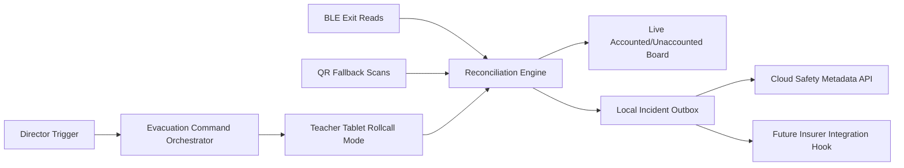

# Implementation Plan: Evacuation Live Rollcall

**Branch**: `012-evacuation-live-rollcall` | **Date**: 2026-07-22 | **Spec**: [spec.md](./spec.md)

## Summary
Provide one-tap evacuation mode that switches teacher tablets into live rollcall, reconciles attendance using BLE gate reads, and supports QR fallback when BLE fails. Preserve insurer integration hooks for future underwriting/compliance workflows.

## Technical Context
- **Language/Version**: TypeScript 5.x
- **Primary Dependencies**: Nx, NestJS emergency command service, BLE occupancy feed, tablet role shell, QR scan module, RabbitMQ/NATS
- **Storage**: Local edge event ledger + cloud evacuation/audit metadata
- **Hardware Dependencies**: Teacher tablets, BLE exit gateways, QR placards/scanners, Edge Box
- **Local Inference Models**: BLE reconciliation heuristics and discrepancy classifier (rules-based)
- **Sync Strategy**: Local command + rollcall ledger with prioritized replay when WAN returns
- **Constraints**: BLE primary with mandatory QR fallback path; insurer API seams required

## Constitution Check (Pre-Design)
- Privacy and edge-first processing: PASS
- Consent/dignity implications: PASS (operational safety accountability)
- Non-diagnostic scope: PASS
- Phase sequencing: PASS (Phase 2 flagship)
- Architecture/offline continuity: PASS

## Edge Box Software Components
- Evacuation Command Orchestrator
- Live Rollcall State Engine
- BLE Exit Reconciliation Service
- QR Fallback Intake Service
- Incident Timeline + Sync Outbox
- Insurer Hook Adapter (disabled by default, contract-ready)

## Data Flow Diagram

## Prisma Data Model Plan
See [data-model.md](./data-model.md).

## API Contracts Plan
See [contracts/api-contracts.md](./contracts/api-contracts.md).

## Testing Strategy
- Unit: reconciliation state transitions, discrepancy reason codes
- Integration: trigger -> tablet mode -> BLE/QR merge
- Resilience: BLE outage with QR-only continuation
- E2E: drill lifecycle from trigger to closeout
- Compliance: immutable timeline and insurer-hook payload schema validation

## Compliance Checks
- Unaccounted child alert SLA tracked and audited
- QR fallback always available when BLE unavailable
- Insurer hooks expose metadata only, no prohibited sensitive media

## Post-Design Constitution Check
PASS: emergency accountability remains edge-first, offline-capable, and insurance-ready via metadata contracts.
