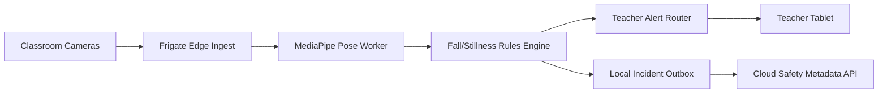

# Implementation Plan: Edge Fall Stillness Alerts

**Branch**: `013-edge-fall-stillness-alerts` | **Date**: 2026-07-22 | **Spec**: [spec.md](./spec.md)

## Summary
Detect fall and unusual stillness events locally on Edge Box and dispatch immediate staff alerts. Use MediaPipe Pose for posture/motion inference and keep outputs strictly non-diagnostic and staff-facing.

## Technical Context
- **Language/Version**: TypeScript 5.x, Python 3.11+
- **Primary Dependencies**: Nx, NestJS alert service, Frigate stream input, MediaPipe Pose, tablet alert client
- **Storage**: Local event buffer + cloud alert metadata/audit trail
- **Hardware Dependencies**: Edge Box + Coral TPU/GPU acceleration, teacher tablets
- **Local Inference Models**: MediaPipe Pose + rules-based fall/stillness threshold engine
- **Sync Strategy**: local alert queue with priority replay and idempotent cloud ingestion
- **Constraints**: inference local-only, no diagnostic labels, low false-alert target

## Constitution Check (Pre-Design)
- Edge-first privacy: PASS
- Consent/dignity and controlled audience: PASS
- Non-diagnostic mandate: PASS
- Phase sequencing: PASS
- Offline continuity: PASS

## Edge Box Software Components
- Pose Inference Worker (MediaPipe Pose)
- Fall/Stillness Event Classifier (rules engine)
- Alert Router + Escalation Engine
- Local Incident Store + Sync Outbox
- Threshold Policy Manager

## Data Flow Diagram

## Prisma Data Model Plan
See [data-model.md](./data-model.md).

## API Contracts Plan
See [contracts/api-contracts.md](./contracts/api-contracts.md).

## Testing Strategy
- Unit: stillness threshold and fall transition logic
- Integration: pose events -> alert lifecycle
- Field tests: occlusion and multi-child scene performance
- Offline: alert dispatch with delayed cloud sync
- Compliance: no diagnosis text and staff-only boundaries

## Compliance Checks
- All inference runs locally
- Alerts contain observational terms only
- Parent-facing channels exclude automated behavioral labels

## Post-Design Constitution Check
PASS: MediaPipe-based detection is local, non-diagnostic, and offline-capable.
