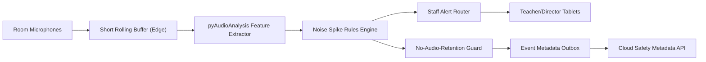

# Implementation Plan: Edge Noise Spike Alerts

**Branch**: `014-edge-noise-spike-alerts` | **Date**: 2026-07-22 | **Spec**: [spec.md](./spec.md)

## Summary
Monitor room noise anomalies at the Edge Box and alert staff on unusual spikes (scream/crash/glass-break patterns). Use pyAudioAnalysis locally; never store or export raw audio recordings.

## Technical Context
- **Language/Version**: TypeScript 5.x, Python 3.11+
- **Primary Dependencies**: Nx, NestJS alert orchestration, pyAudioAnalysis, edge audio feature worker
- **Storage**: event metadata only (decibel/anomaly stats, no raw audio)
- **Hardware Dependencies**: calibrated room microphones, Edge Box compute, staff tablets
- **Local Inference Models**: pyAudioAnalysis feature extraction + anomaly threshold rules
- **Sync Strategy**: event metadata outbox replay, strict no-audio persistence checks
- **Constraints**: audio never recorded/stored; only event-level alerts persist

## Constitution Check (Pre-Design)
- Edge-first privacy: PASS
- Consent/dignity handling: PASS
- Non-diagnostic outputs: PASS
- Phase sequencing: PASS
- Offline continuity compatibility: PASS

## Edge Box Software Components
- Audio Feature Worker (short rolling buffer)
- pyAudioAnalysis Anomaly Detector
- Spike Alert Router and Escalation Service
- No-Audio-Retention Guardrail Service
- Event Metadata Outbox

## Data Flow Diagram

## Prisma Data Model Plan
See [data-model.md](./data-model.md).

## API Contracts Plan
See [contracts/api-contracts.md](./contracts/api-contracts.md).

## Testing Strategy
- Unit: anomaly threshold and debounce logic
- Integration: feature extraction -> alert lifecycle
- Compliance: prove zero raw audio persistence/export
- Offline: local alerts during WAN loss, replay metadata on restore
- Field tuning: minimize false-positive spikes per room profile

## Compliance Checks
- Audio retention guard blocks any recording path
- Persist only event-level metrics and alerts
- Staff-facing alerts remain non-diagnostic

## Post-Design Constitution Check
PASS: pyAudioAnalysis usage is local-only with strict no-audio-storage enforcement.
