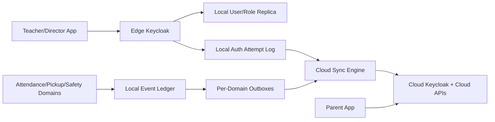

# Implementation Plan: Edge Offline Continuity

**Branch**: `015-edge-offline-continuity` | **Date**: 2026-07-22 | **Spec**: [spec.md](./spec.md)

**Input**: Feature specification from `/specs/015-edge-offline-continuity/spec.md`

## Summary
Implement platform-wide offline-first continuity so all critical Phase 1 and Phase 2 workflows continue during WAN outages, including Edge Keycloak local authentication fallback for teachers/directors. Parent login remains Cloud Keycloak only.

## Technical Context

**Language/Version**: TypeScript 5.x, Python 3.11+

**Primary Dependencies**: Nx, NestJS services, RabbitMQ/NATS local bus, Prisma, edge sync engine, Edge Keycloak container, Keycloak sync service

**Storage**: Local append-only operations ledger + local read-only user/role replica + cloud metadata stores

**Testing**: Unit, integration, chaos outage tests, offline auth tests, sync replay tests, compliance tests

**Target Platform**: Edge Box runtime, staff/director app surfaces, cloud services

**Project Type**: Cross-domain resilience architecture feature

**Performance Goals**: local auth validation <1s p95; queued operation replay start <30s after reconnect

**Constraints**: parent login always cloud-only; no offline parent auth; auditable local login attempts and delayed sync

## Constitution Check

- Privacy and edge-first gate: PASS.
- Consent gate: PASS.
- Non-diagnostic gate: PASS.
- Phase gate: PASS.
- Architecture gate: PASS and mandatory.
- Regulatory gate: PASS with audit and retention controls.

## Edge Box Software Components

- Local Operations Bus and Durable Event Ledger
- Domain Outbox/Inbox Sync Engine
- Edge Keycloak lightweight container
- Local read-only user and role replica store
- Auth Attempt Logger and Replay Publisher
- Sync Health Monitor and Director Visibility API

## Keycloak Fallback Architecture

- Edge Keycloak synchronizes staff/director identities and role assignments from Cloud Keycloak on schedule.
- During WAN outage, Edge Keycloak validates staff/director credentials against local replicated identity data.
- Offline login attempts are written to local audit log and replayed to cloud audit pipelines on reconnect.
- Parent authentication path is blocked in offline mode and requires Cloud Keycloak reachability.

## Data Flow Diagram

## Prisma Data Model Plan

- Existing continuity entities remain: `ConnectivitySession`, `LocalOperationRecord`, `DomainOutboxItem`, `SyncCheckpoint`, `ReconciliationDecision`, `OfflineAuditEvent`.
- Add `OfflineAuthAttempt(id, userRef, roleClass, issuer, outcome, reasonCode, occurredAt, syncedAt)`.
- Add `IdentityReplicaCheckpoint(id, sourceRealm, lastSyncAt, status, driftCount)`.

## API Contracts Plan

See [contracts/api-contracts.md](./contracts/api-contracts.md).

## Dependencies

- Internal: pickup verification module, role policy service, audit service, keycloak sync service
- External: Cloud Keycloak, Edge Keycloak runtime
- Config: sync cadence, offline auth policy, parent cloud-only login policy

## Testing Strategy

- Unit: idempotent replay, auth fallback decision policy
- Integration: outage auth for staff/director and cloud-only parent path enforcement
- Chaos: connectivity flapping, keycloak sync lag, replica drift
- E2E: full day operation with WAN disabled and reconnect replay validation
- Compliance: verify offline auth logs are synced and immutable

## Post-Design Constitution Check

PASS after design:
- Edge Keycloak local fallback is defined for staff roles.
- Parent cloud-only login boundary is explicit.
- Offline operations and authentication are auditable and replay-safe.
