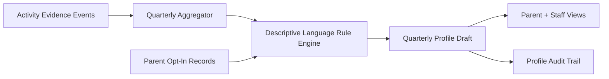

# Implementation Plan: Quarterly Interest Profile

**Branch**: `016-quarterly-interest-profile` | **Date**: 2026-07-22 | **Spec**: [spec.md](./spec.md)

## Summary
Create a quarterly descriptive child interest snapshot for parents and staff using activity evidence aggregation only. Outputs are strictly descriptive, no scores, no labels, and no child-to-child comparisons.

## Technical Context
- **Language/Version**: TypeScript 5.x
- **Primary Dependencies**: Nx, NestJS profile aggregation service, Prisma, role-based app views
- **Storage**: PostgreSQL metadata only (activity evidence and profile narrative entries)
- **Project Type**: Unified application with parent/staff profile rendering
- **Data Aggregation Logic**: Aggregate classroom activity events by child, category, and time window into descriptive trend summaries (counts and frequencies internal only)
- **Rules-Based Flagging (Phase 3)**: N/A for risk labels; only rules for narrative inclusion/exclusion quality checks
- **Consent Opt-In Flow**: Parent opt-in for profile generation and sharing scope controls; revocation stops new profile generation
- **Clinical Review Checklist**: Verify language remains descriptive and non-diagnostic prior to release
- **Constraints**: No scores, no behavioral labels, no comparisons, low regulatory-risk descriptive framing

## Constitution Check (Pre-Design)
- Privacy by default and edge-first obligations: PASS
- Explicit consent and child data dignity: PASS
- Safety-first non-diagnostic boundaries: PASS
- Phase sequencing obligations: PASS (Phase 3 descriptive insight)
- Architecture integrity: PASS

## Data Aggregation Logic
- Collect approved activity evidence events (art, reading, movement, collaboration, sensory play).
- Group by child and quarter.
- Generate descriptive snippets from deterministic templates, e.g., "enjoyed sensory table activities on multiple days".
- Exclude any comparative phrases ("more than peers", "below average") via phrase-block rules.

## Rules-Based Controls (No ML)
- Rule 1: Disallow numeric child scoring output in API/view layers.
- Rule 2: Disallow diagnostic and label lexicon.
- Rule 3: Disallow inter-child ranking/comparison statements.
- Rule 4: Require minimum evidence count before emitting a descriptive statement.

## Consent Opt-In Flow
1. Parent enables quarterly profile in settings.
2. System records scope (parent-only, parent+authorized staff).
3. Profile generation job checks active consent snapshot.
4. Revoked consent halts future generation and hides unpublished drafts.

## Clinical Review Checklist
- [ ] Language contains no diagnosis terms.
- [ ] Language contains no risk scoring.
- [ ] No comparison to peer cohorts.
- [ ] Statements are evidence-backed and timestamped.
- [ ] Final template set approved by clinical advisor before launch.

## Data Flow Diagram

## Prisma Data Model Plan
See [data-model.md](./data-model.md).

## API Contracts Plan
See [contracts/api-contracts.md](./contracts/api-contracts.md).

## Testing Strategy
- Unit: template rules, banned phrase filters, no-score assertion checks
- Integration: event ingestion -> aggregation -> profile generation
- Consent: opt-in/opt-out behavior and scope enforcement
- Compliance: non-diagnostic language and no-comparison guarantees

## Post-Design Constitution Check
PASS: descriptive-only outputs enforced with explicit no-score/no-label/no-comparison guards.
