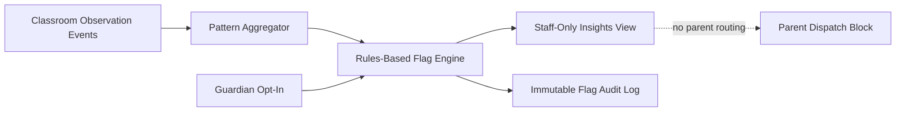

# Implementation Plan: Teacher Pattern Insights

**Branch**: `017-teacher-pattern-insights` | **Date**: 2026-07-22 | **Spec**: [spec.md](./spec.md)

## Summary
Deliver staff-only pattern insights using rules-based observational flags and plain-language non-diagnostic phrasing. No automatic parent messaging is allowed. Every flag must be auditable and threshold sets require clinical advisor review before launch.

## Technical Context
- **Language/Version**: TypeScript 5.x
- **Primary Dependencies**: Nx, NestJS insight rules service, Prisma, role-based access control service
- **Storage**: PostgreSQL for event aggregates, generated flags, and immutable audit logs
- **Data Aggregation Logic**: aggregate attendance/activity transitions, engagement observations, and classroom context by child and timeframe
- **Rules-Based Flagging (NOT ML)**: deterministic threshold/rule matrix only
- **Consent Opt-In Flow**: guardian opt-in for observational insight processing; staff visibility bound by role permissions
- **Clinical Review Checklist**: mandatory clinical advisor sign-off on thresholds + phrase catalog before activation
- **Constraints**: staff-only visibility, plain language only, never "ADHD risk" or "autism flag", never auto-send to parents

## Constitution Check (Pre-Design)
- Privacy and edge-first obligations: PASS
- Explicit consent and child dignity: PASS
- Non-diagnostic guardrail: PASS (critical)
- Phase sequencing obligations: PASS (Phase 3)
- Architecture integrity: PASS

## Data Aggregation Logic
- Windowed aggregation of observed engagement events per routine block.
- Context-normalized counts (time-of-day and classroom activity type).
- Build staff-facing observation summaries from deterministic templates.

## Rules-Based Flagging (Phase 3)
- Rule A: "Reduced engagement observed" when engagement indicators fall below configured threshold across multiple sessions.
- Rule B: "Transition difficulty observed" when routine transition support events exceed threshold.
- Rule C: "Escalation needed" when unresolved staff interventions exceed policy window.
- Rule D: Hard block any diagnosis/clinical label terms in generated text.

## Staff-Only Boundary
- API and UI routes enforce teacher/director roles only.
- Parent channels and parent UI surfaces excluded by route-level policy.
- Notification service policy denies outbound parent dispatch for this domain.

## Consent Opt-In Flow
1. Guardian grants opt-in for observational insight processing.
2. Consent snapshot linked to child profile.
3. Rules engine executes only with active consent.
4. Revocation removes child from future flag generation.

## Clinical Review Checklist
- [ ] Threshold matrix reviewed and signed by clinical advisor.
- [ ] Phrase catalog uses non-diagnostic plain language.
- [ ] Parent-facing integrations explicitly disabled.
- [ ] Audit events recorded for each generated/updated/resolved flag.
- [ ] Alert escalation policy tested against false-positive target.

## Data Flow Diagram

## Prisma Data Model Plan
See [data-model.md](./data-model.md).

## API Contracts Plan
See [contracts/api-contracts.md](./contracts/api-contracts.md).

## Testing Strategy
- Unit: threshold rule evaluation, blocked terminology filter, role boundary checks
- Integration: event aggregation -> rule flags -> staff dashboard
- Consent: opt-in gating and revocation behavior
- Compliance: verify no parent auto-send pathways
- Audit: verify complete lifecycle logging for every flag

## Post-Design Constitution Check
PASS: staff-only non-diagnostic rules-based insights with mandatory clinical threshold review and full auditability.
