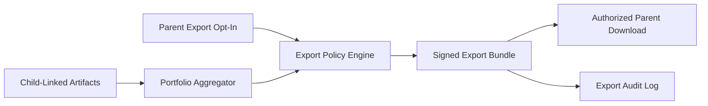

# Implementation Plan: Keepsake Portfolio Export

**Branch**: `018-keepsake-portfolio-export` | **Date**: 2026-07-22 | **Spec**: [spec.md](./spec.md)

## Summary
Provide privacy-safe keepsake portfolio export for parents as a retention and upsell feature. Export scope is strictly single-child/single-family authorized content; bulk export of other children’s content is blocked.

## Technical Context
- **Language/Version**: TypeScript 5.x
- **Primary Dependencies**: Nx, NestJS portfolio service, media catalog service, authorization service, export worker
- **Storage**: PostgreSQL metadata + object storage references with strict ACL mapping
- **Data Aggregation Logic**: aggregate approved child artifacts (photos, milestones, teacher notes) by time range and export template
- **Rules-Based Flagging (Phase 3)**: deterministic access-policy checks and export eligibility rules
- **Consent Opt-In Flow**: parent opt-in for portfolio inclusion and share/export preferences
- **Clinical Review Checklist**: review language in auto-curated notes to ensure non-diagnostic phrasing
- **Constraints**: no cross-child bulk export, privacy-by-default ACL enforcement

## Constitution Check (Pre-Design)
- Privacy by default and residency controls: PASS
- Explicit consent and dignity: PASS
- Non-diagnostic boundaries: PASS
- Phase sequencing: PASS (Phase 3 retention/upsell)
- Architecture integrity: PASS

## Data Aggregation Logic
- Collect child-linked approved content items by date range.
- Filter by guardian authorization and consent scope.
- Assemble export package from deterministic template sections.
- Exclude any media without explicit child linkage and permission.

## Rules-Based Controls (No ML)
- Rule 1: Export request must reference exactly one authorized child context.
- Rule 2: Reject export if any asset ownership scope mismatch exists.
- Rule 3: Disallow directory-level or multi-child wildcard requests.
- Rule 4: Require one-time export token and audit every download.

## Consent Opt-In Flow
1. Parent enables keepsake export preference.
2. Parent selects share policy (private download only / authorized share).
3. System stores consent snapshot used at export time.
4. Revocation blocks new exports and expires pending tokens.

## Clinical Review Checklist
- [ ] Narrative captions avoid diagnostic or clinical claims.
- [ ] Teacher notes export templates reviewed for plain language.
- [ ] Export privacy disclaimer reviewed.
- [ ] Access control test suite passes cross-child leak checks.

## Data Flow Diagram

## Prisma Data Model Plan
See [data-model.md](./data-model.md).

## API Contracts Plan
See [contracts/api-contracts.md](./contracts/api-contracts.md).

## Testing Strategy
- Unit: ACL checks, asset-scope validator, token expiration rules
- Integration: content aggregation -> bundle generation -> secure download
- Security: attempt cross-child and bulk export attacks
- Consent: export behavior under opt-out and revoked token states
- Compliance: verify audit logs for each request and download

## Post-Design Constitution Check
PASS: retention-oriented export feature preserves strict privacy boundaries and consent controls.
