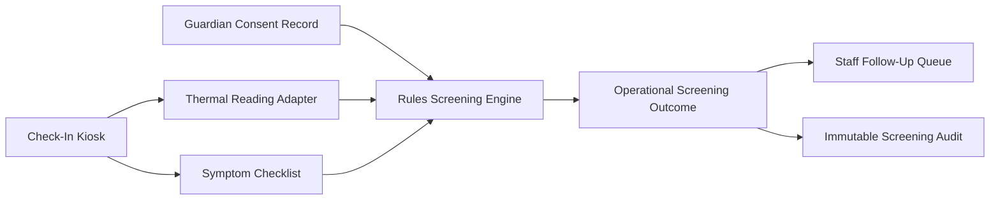

# Implementation Plan: Kiosk Illness Screening

**Branch**: `019-kiosk-illness-screening` | **Date**: 2026-07-22 | **Spec**: [spec.md](./spec.md)

## Summary
Implement kiosk wellness check workflow as a screening aid only, combining thermal temperature capture and symptom checklist responses. The feature is explicitly non-diagnostic and produces operational guidance for staff follow-up.

## Technical Context
- **Language/Version**: TypeScript 5.x
- **Primary Dependencies**: Nx, NestJS screening service, kiosk UI module, thermal sensor integration adapter, Prisma
- **Storage**: screening metadata and audit logs (no medical diagnosis artifacts)
- **Data Aggregation Logic**: combine thermal reading bands and checklist responses into deterministic screening outcomes
- **Rules-Based Flagging (NOT ML)**: threshold and checklist rule matrix only
- **Consent Opt-In Flow**: guardian consent for screening data capture and operational handling notices
- **Clinical Review Checklist**: advisor review of thresholds, phrasing, escalation routing, and disclaimer language
- **Constraints**: screening aid only; not a diagnostic device

## Constitution Check (Pre-Design)
- Privacy and sensitive data handling: PASS
- Explicit consent and data dignity: PASS
- Non-diagnostic product boundary: PASS (critical)
- Phase sequencing obligations: PASS (Phase 3)
- Architecture integrity and auditability: PASS

## Data Aggregation Logic
- Ingest thermal reading at check-in time.
- Capture symptom checklist responses.
- Evaluate deterministic rules for outcome bucket: "clear", "review with staff", "hold for supervisor check".
- Record rationale code for each outcome.

## Rules-Based Flagging (Phase 3)
- Rule 1: Temperature above configured threshold -> "review with staff".
- Rule 2: Multiple symptom indicators -> "hold for supervisor check".
- Rule 3: Contradictory inputs (sensor error + symptoms) -> manual recheck required.
- Rule 4: Block all diagnostic language output; show operational next-step instructions only.

## Consent Opt-In Flow
1. Guardian acknowledges screening consent and purpose notice.
2. Kiosk session validates active consent at check-in.
3. If consent absent, route to manual staff process per policy.
4. Revocation updates prevent subsequent automated screening captures.

## Clinical Review Checklist
- [ ] Thermal threshold values reviewed by clinical advisor.
- [ ] Symptom checklist phrasing reviewed for non-diagnostic wording.
- [ ] Escalation instructions reviewed and approved.
- [ ] Disclaimer "screening aid, not diagnostic device" shown in UI.
- [ ] Audit logging verified for each screening decision.

## Data Flow Diagram

## Prisma Data Model Plan
See [data-model.md](./data-model.md).

## API Contracts Plan
See [contracts/api-contracts.md](./contracts/api-contracts.md).

## Testing Strategy
- Unit: threshold rule matrix, disclaimer enforcement, rationale code mapping
- Integration: kiosk session -> sensor + checklist -> outcome routing
- Consent: gating behavior and manual fallback path
- Compliance: ensure non-diagnostic wording and audit completeness
- Hardware: thermal adapter calibration and error handling

## Post-Design Constitution Check
PASS: wellness check remains a non-diagnostic screening workflow with deterministic rules and explicit consent controls.
