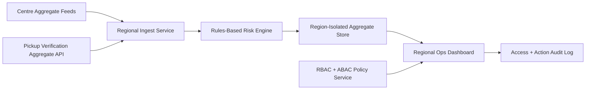

# Implementation Plan: Regional Safety Ops Dashboard

**Branch**: `020-regional-safety-ops-dashboard` | **Date**: 2026-07-22 | **Spec**: [spec.md](./spec.md)

## Summary
Deliver a regional operations dashboard that surfaces cross-centre safety posture using aggregated, anonymized metadata only. The solution enforces strict multi-region (US, EU, GCC) data isolation and role-based access so managers see only authorized centre scopes.

## Technical Context
- **Language/Version**: TypeScript 5.x
- **Primary Dependencies**: Nx, NestJS regional-analytics service, Prisma, role-policy service, TimescaleDB aggregates
- **Storage**: Regional PostgreSQL partitions (US/EU/GCC) for anonymized operational aggregates and audit logs
- **Data Aggregation Logic**: consume centre-level event summaries (ratio, incident, evacuation, pickup verification outcomes) and compute regional trend snapshots in fixed windows
- **Rules-Based Flagging (NOT ML)**: deterministic risk-band rules based on threshold matrix
- **Consent Opt-In Flow**: consumes only already-consented operational metadata streams; no new biometric consent collection at dashboard layer
- **Clinical Review Checklist**: verify labels remain operational/non-diagnostic and thresholds are advisor-reviewed where behavioral-derived fields appear
- **Constraints**: no raw video, no embeddings, no per-child identity display in regional tier

## Constitution Check (Pre-Design)
- Privacy by default and edge-first inference: PASS
- Explicit consent and child data dignity: PASS
- Safety-first non-diagnostic boundaries: PASS
- Phase sequencing obligations: PASS (Phase 4 scale extension)
- Architecture integrity and offline continuity: PASS

## Multi-Tenant Data Isolation Strategy
- Tenant model: `region -> organization -> centre` hierarchy with hard tenant keys.
- Physical/logical isolation: separate region-scoped databases for US, EU, GCC.
- Query guardrails: mandatory tenant and region predicates enforced in data-access layer.
- Key management: region-local encryption keys and isolated secret stores.
- Cross-region analytics: prohibit raw row federation; allow only pre-aggregated anonymized export tables when policy-approved.

## Role-Based Access Controls
- Regional Manager: read-only for assigned centres in one region.
- Regional Director: read + action assignment across owned organizations.
- Compliance Reviewer: read audit and trend evidence only.
- Platform Admin: no data read by default; break-glass workflow with audit capture.
- Policy enforcement: RBAC + ABAC checks on region, org, centre scope.

## Integration with Existing Pickup Verification Module
- Reuse aggregated outcomes from `010-pickup-guardian-verification` (approved/denied counts, unauthorized attempts, escalation latency).
- Consume pickup module contracts as read-only regional metrics feed.
- Do not duplicate verification logic in dashboard domain.

## Data Aggregation Logic
- Ingest site snapshots (5-min rolling windows): ratio status, incident counts, pickup anomalies, evacuation readiness, visitor occupancy.
- Normalize to region-local time windows.
- Compute deterministic risk bands:
  - Green: no open severe alerts and ratio compliance stable.
  - Amber: threshold breaches or repeated unauthorized attempts.
  - Red: unresolved critical incidents or sustained non-compliance.
- Persist only anonymized centre-level aggregates and audit references.

## Rules-Based Flagging (Phase 4)
- Rule R1: `red` if critical incident unresolved > configured SLA.
- Rule R2: `amber` if pickup unauthorized-attempt rate exceeds threshold.
- Rule R3: `amber/red` for repeated ratio breaches in rolling window.
- Rule R4: block display if data freshness SLA violated; show `stale` status.

## Clinical Review Checklist
- [ ] Regional labels contain no diagnostic wording.
- [ ] Threshold matrix reviewed for behavioral-derived metrics.
- [ ] Cross-region access boundaries penetration tested.
- [ ] Aggregation outputs verified as anonymized metadata only.
- [ ] Pickup-derived metrics reviewed for interpretation language.

## Data Flow Diagram

## Prisma Data Model Plan
See [data-model.md](./data-model.md).

## API Contracts Plan
See [contracts/api-contracts.md](./contracts/api-contracts.md).

## Testing Strategy
- Unit: tenant-scope query filters, risk-band rule evaluation
- Integration: regional ingest -> aggregation -> dashboard rendering
- Security: cross-tenant and cross-region access denial tests
- Compliance: prove no raw media fields in regional storage
- Resilience: stale-feed handling and region failover playbooks

## Post-Design Constitution Check
PASS: dashboard is aggregated/anonymized, region-isolated, RBAC-bound, and non-diagnostic.
