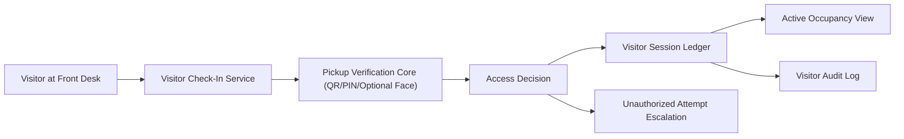

# Implementation Plan: Verified Visitor Check-In

**Branch**: `021-verified-visitor-checkin` | **Date**: 2026-07-22 | **Spec**: [spec.md](./spec.md)

## Summary
Extend existing Pickup Verification capabilities to visitor check-in with expiry-based credentials and building occupancy tracking. Reuse QR/PIN + optional local facial verification logic from Phase 2 module; do not rebuild identity-verification primitives.

## Technical Context
- **Language/Version**: TypeScript 5.x, Python 3.11+ for local optional facial path
- **Primary Dependencies**: Nx, NestJS visitor-access service, existing pickup verification module, Prisma, RBAC policy service
- **Storage**: visitor session metadata and audit logs in PostgreSQL; optional biometric artifacts remain local-only per pickup policy
- **Data Aggregation Logic**: aggregate visitor check-in/out events into active occupancy and daily compliance summaries
- **Rules-Based Flagging (NOT ML)**: deterministic rules for credential validity, expiry, override escalation, and occupancy exceptions
- **Consent Opt-In Flow**: visitor notice/consent acknowledgment plus optional biometric consent when facial path is used
- **Clinical Review Checklist**: confirm wording remains operational access language and non-diagnostic
- **Constraints**: lower priority extension; reuse pickup module and policies, avoid duplicate verification stack

## Constitution Check (Pre-Design)
- Privacy by default and edge-first inference: PASS
- Explicit consent and data dignity: PASS
- Safety-first non-diagnostic boundaries: PASS
- Phase sequencing obligations: PASS (Phase 4 extension)
- Architecture integrity and offline continuity: PASS

## Multi-Tenant Data Isolation Strategy
- Visitor records partitioned by `regionCode + organizationId + centreId`.
- Access tokens embed tenant scope claims.
- Data-access layer requires tenant filters on all read/write operations.
- Cross-centre exports disabled by default; supervisory cross-centre view requires explicit scope grant.

## Role-Based Access Controls
- Front Desk Staff: create/check-in/check-out within assigned centre.
- Director: approve overrides, review active occupancy and history for centre.
- Regional Compliance: read-only aggregate reports in scoped region.
- Security Admin: policy management only, no unrestricted data reads.

## Integration with Existing Pickup Verification Module
- Reuse pickup verifier APIs for QR/PIN + optional facial match pathways.
- Reuse biometric retention policy (default 7-day local auto-delete where applicable).
- Reuse unauthorized attempt escalation logic and reason-code taxonomy.
- Visitor module adds credential type `visitor-temporary` and session lifecycle; core verification stays in pickup module.

## Data Aggregation Logic
- Build active occupancy roster from verified check-ins minus check-outs.
- Aggregate per-centre daily metrics: total visitors, denied attempts, override count, average visit duration.
- Maintain reconciliation job for stale sessions (forgotten check-out).

## Rules-Based Flagging (Phase 4)
- Rule V1: deny expired credential at entry.
- Rule V2: deny centre-mismatched credential.
- Rule V3: escalate repeated denied attempts within rolling window.
- Rule V4: mark `stale-active-visitor` when max visit duration exceeded without checkout.

## Consent Opt-In Flow
1. Visitor receives privacy notice at check-in.
2. Visitor accepts identity processing consent for access control.
3. Optional facial path requires explicit additional consent.
4. Revoked/declined biometric consent falls back to QR/PIN only.

## Clinical Review Checklist
- [ ] Verify no diagnostic or health claims in visitor flow text.
- [ ] Verify optional biometric notice language is clear and limited.
- [ ] Verify retention and deletion messaging aligns with pickup policy.
- [ ] Verify escalation wording is operational and non-clinical.

## Data Flow Diagram

## Prisma Data Model Plan
See [data-model.md](./data-model.md).

## API Contracts Plan
See [contracts/api-contracts.md](./contracts/api-contracts.md).

## Testing Strategy
- Unit: expiry, tenant scope, and override rules
- Integration: visitor check-in -> pickup core verification -> session tracking
- Security: replay/forged credential and cross-centre access attempts
- Offline: local capture and sync for outages
- Compliance: retention, consent, and audit completeness checks

## Post-Design Constitution Check
PASS: visitor workflow is extension-based, privacy-safe, tenant-isolated, RBAC-bound, and reuse-first.
